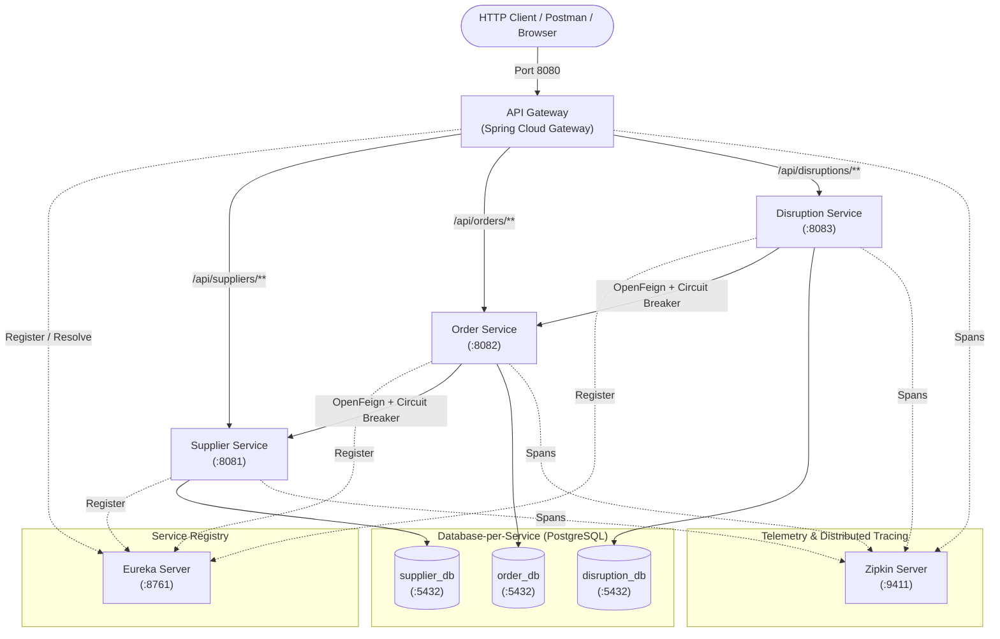

# Multi-Tier Supply Chain Disruption & Resilience Tracker (SC-RESILIENCE)

A cloud-native, distributed microservice architecture designed to provide end-to-end visibility across multi-tier supplier networks, isolate business domains, eliminate single points of failure, and track cascading disruption impacts in real time.

---

## 1. Architecture & Tech Stack

- **Language / Runtime**: Java 17
- **Framework**: Spring Boot 3.3.4
- **Cloud Infrastructure**: Spring Cloud 2023.0.3
- **Service Registry & Discovery**: Netflix Eureka Server
- **API Gateway**: Spring Cloud Gateway (Reactive Non-blocking reverse proxy)
- **Inter-Service Communication**: Spring Cloud OpenFeign (with Apache HttpClient 5 for HTTP PATCH support)
- **Fault Tolerance & Resilience**: Resilience4j Circuit Breakers & Fallback Factories
- **Distributed Tracing**: Micrometer Tracing (Brave bridge) + Zipkin Reporter
- **Monitoring & Health**: Spring Boot Actuator
- **Containerization & Orchestration**: Docker (Multi-stage builds) & Docker Compose
- **Persistence**: Spring Data JPA + PostgreSQL 15 (Database-per-Service pattern)
- **API Documentation**: SpringDoc OpenAPI 3 / Swagger UI

### High-Level Architecture Diagram



---

## 2. Microservice Topology & Port Allocations

| Service | Port | Actuator Health Endpoint | Swagger UI Endpoint | Database | Primary Responsibilities |
| :--- | :--- | :--- | :--- | :--- | :--- |
| **`eureka-server`** | `8761` | `http://localhost:8761/actuator/health` | *N/A* | *N/A* | Centralized service registry for discovery, dynamic routing, and instance heartbeat management. |
| **`api-gateway`** | `8080` | `http://localhost:8080/actuator/health` | *N/A* | *N/A* | Unified ingress edge proxy (`lb://`), request logging, routing, and trace header propagation. |
| **`supplier-service`** | `8081` | `http://localhost:8081/actuator/health` | `http://localhost:8081/swagger-ui.html` | `supplier_db` | Master vendor passports, tier hierarchy (Tier 1–5), ESG compliance scores, and manufacturing facilities. |
| **`order-service`** | `8082` | `http://localhost:8082/actuator/health` | `http://localhost:8082/swagger-ui.html` | `order_db` | Purchase order placement, line-item allocation, and delivery scheduling. Validates vendors via OpenFeign. |
| **`disruption-service`** | `8083` | `http://localhost:8083/actuator/health` | `http://localhost:8083/swagger-ui.html` | `disruption_db` | Regional disruption ingestion (port congestion, strikes, weather alerts) and automated cascading impact flagging. |

---

## 3. Resilience, Fault Tolerance & Distributed Tracing

### 3.1 Resilience4j Circuit Breakers & Fallbacks
- **OpenFeign Circuit Breaker Integration**: Activated via `spring.cloud.openfeign.circuitbreaker.enabled=true`.
- **Fallback Factories**:
  - `SupplierClientFallbackFactory` (`order-service`): Returns a degraded fallback `SupplierDTO` with status `TEMPORARILY_UNAVAILABLE` when `SUPPLIER-SERVICE` is unavailable or times out, protecting order processing from cascading thread pool exhaustion.
  - `OrderClientFallbackFactory` (`disruption-service`): Catches downstream failures gracefully when cascading regional facility disruption alerts to `ORDER-SERVICE`.
- **Circuit Breaker Tuning**:
  ```properties
  resilience4j.circuitbreaker.configs.default.sliding-window-size=10
  resilience4j.circuitbreaker.configs.default.minimum-number-of-calls=5
  resilience4j.circuitbreaker.configs.default.failure-rate-threshold=50
  resilience4j.circuitbreaker.configs.default.wait-duration-in-open-state=10s
  resilience4j.circuitbreaker.configs.default.permitted-number-of-calls-in-half-open-state=3
  ```

### 3.2 Distributed Tracing with Micrometer & Zipkin
- Correlates end-to-end distributed transaction logs across:
  `api-gateway` -> `order-service` / `disruption-service` -> `supplier-service`.
- **Sampling Probability**: 100% (`management.tracing.sampling.probability=1.0`).
- **Zipkin Span Ingestion Endpoint**: `http://localhost:9411/api/v2/spans`.
- **Correlated Log Pattern**: `%5p [${spring.application.name:},%X{traceId:-},%X{spanId:-}]`.

---

## 4. Containerization & Monitoring

### 4.1 Production Observability with Spring Boot Actuator
All services expose production-grade health, telemetry, and environment endpoints:
- `GET /actuator/health` - Comprehensive liveness and readiness statuses with subsystem breakdown.
- `GET /actuator/info` - Service application runtime metadata.
- `GET /actuator/metrics` - JVM heap, thread count, garbage collection, and HTTP request metrics.

### 4.2 Multi-Stage Docker Builds
Every service utilizes a multi-stage `Dockerfile`:
1. **Build Stage** (`eclipse-temurin:17-jdk-alpine`): Copies Maven wrapper files first to leverage Docker layer caching for dependencies before building the executable fat JAR.
2. **Runtime Stage** (`eclipse-temurin:17-jre-alpine`): Strips build tools, resulting in a lightweight, secure, production-ready JRE container.

### 4.3 Multi-Container Docker Compose Stack
The root [docker-compose.yml](file:///d:/MSA_project/docker-compose.yml) starts the entire ecosystem with automated health checks (`condition: service_healthy`):
- `postgres` (initializes `supplier_db`, `order_db`, and `disruption_db` automatically via `init-scripts/01-init-databases.sql`)
- `zipkin` (distributed trace collector & visualization web dashboard)
- `eureka-server` (service registry with Actuator health verification)
- `supplier-service`, `order-service`, `disruption-service` (dependent on PostgreSQL & Eureka)
- `api-gateway` (edge router dependent on Eureka)

---

## 5. API Endpoints Reference

All endpoints can be invoked directly on individual service ports or via the API Gateway on port `8080`.

### 5.1 Supplier Service (`/api/suppliers` via Gateway: `http://localhost:8080/api/suppliers`)

* **Create Supplier & Facilities**: `POST /api/suppliers`
  ```json
  {
    "legalName": "Apex Semiconductor",
    "tierLevel": 2,
    "esgComplianceScore": 95.50,
    "status": "ACTIVE",
    "facilities": [
      {
        "geoLatitude": 19.0760,
        "geoLongitude": 72.8777,
        "regionCode": "IN-MH",
        "capacityUnitsDay": 5000
      }
    ]
  }
  ```
* **Get All Suppliers**: `GET /api/suppliers`
* **Get Supplier by ID**: `GET /api/suppliers/{id}`
* **Delete Supplier**: `DELETE /api/suppliers/{id}`

### 5.2 Order Service (`/api/orders` via Gateway: `http://localhost:8080/api/orders`)

* **Create Purchase Order (with Inter-Service Validation & Circuit Breaker)**: `POST /api/orders`
  ```json
  {
    "supplierId": "<VALID_SUPPLIER_UUID>",
    "destFacilityId": "<VALID_FACILITY_UUID>",
    "expectedDelivery": "2026-09-15T10:00:00",
    "lineItems": [
      {
        "quantity": 500,
        "unitPrice": 12.75
      }
    ]
  }
  ```
  - **Success (`201 Created`)**: Validates supplier against `supplier-service` and records order as `CONFIRMED`.
  - **Circuit Breaker Fallback**: If `supplier-service` is down, `SupplierClientFallbackFactory` prevents a 500 crash and returns a degraded response.
* **Get All Orders**: `GET /api/orders`
* **Get Order by ID**: `GET /api/orders/{id}`
* **Update Order Status by Facility**: `PATCH /api/orders/flag-facility/{facilityId}/{status}`

### 5.3 Disruption Ingestion Service (`/api/disruptions` via Gateway: `http://localhost:8080/api/disruptions`)

* **Ingest Disruption & Trigger Downstream Propagation**: `POST /api/disruptions`
  ```json
  {
    "eventType": "PORT_CONTAINER_CONGESTION",
    "severityIndex": 8,
    "sourceRegionCode": "IN-MH",
    "impacts": [
      {
        "facilityId": "<TARGET_FACILITY_UUID>",
        "estDelayDays": 14,
        "status": "OPERATIONS_HALTED"
      }
    ]
  }
  ```
  - **Behavior**: Records disruption in `disruption_db` and flags matching orders in `order-service` via OpenFeign. If `order-service` is unreachable, `OrderClientFallbackFactory` recovers gracefully.
* **Get All Disruptions**: `GET /api/disruptions`
* **Get Disruption by ID**: `GET /api/disruptions/{id}`

---

## 6. Execution Guide

### Option A: Complete Docker Compose Orchestration (Recommended)

1. **Start the Entire Cluster**:
   ```bash
   docker compose up --build -d
   ```
2. **Check Container Status & Health**:
   ```bash
   docker compose ps
   ```
3. **Follow Real-time Logs Across Services**:
   ```bash
   docker compose logs -f
   ```
4. **Stop the Platform**:
   ```bash
   docker compose down
   ```
   *(To wipe persisted volumes as well, run `docker compose down -v`)*

---

### Option B: Local Execution (Native Spring Boot + Docker for Infra)

1. **Prerequisites**:
   - Java JDK 17+
   - PostgreSQL 15+ (running on port `5432` with credentials `postgres` / `root`)
   - Docker (for Zipkin)

2. **Initialize Databases**:
   Run the SQL statements from [01-init-databases.sql](file:///d:/MSA_project/init-scripts/01-init-databases.sql):
   ```sql
   CREATE DATABASE supplier_db;
   CREATE DATABASE order_db;
   CREATE DATABASE disruption_db;
   ```

3. **Start Zipkin Distributed Tracing**:
   ```bash
   docker run -d -p 9411:9411 --name zipkin openzipkin/zipkin
   ```

4. **Launch Microservices (in order)**:
   Open dedicated terminal windows and run each service with the Maven wrapper:

   - **Terminal 1 - Eureka Server**:
     ```powershell
     cd eureka-server; .\mvnw spring-boot:run
     ```
     *Dashboard:* `http://localhost:8761`

   - **Terminal 2 - API Gateway**:
     ```powershell
     cd api-gateway; .\mvnw spring-boot:run
     ```
     *Gateway Ingress:* `http://localhost:8080`

   - **Terminal 3 - Supplier Service**:
     ```powershell
     cd supplier-service; .\mvnw spring-boot:run
     ```

   - **Terminal 4 - Order Service**:
     ```powershell
     cd order-service; .\mvnw spring-boot:run
     ```

   - **Terminal 5 - Disruption Service**:
     ```powershell
     cd disruption-service; .\mvnw spring-boot:run
     ```

---

## 7. Verification & Testing

### 7.1 Actuator Health Checks
Verify liveness and readiness across all components:
- **API Gateway**: `curl http://localhost:8080/actuator/health`
- **Eureka Server**: `curl http://localhost:8761/actuator/health`
- **Supplier Service**: `curl http://localhost:8081/actuator/health`
- **Order Service**: `curl http://localhost:8082/actuator/health`
- **Disruption Service**: `curl http://localhost:8083/actuator/health`

### 7.2 Testing Circuit Breaker & Fallback
1. Stop `supplier-service`:
   ```bash
   docker compose stop supplier-service
   # Or press Ctrl+C in its local terminal
   ```
2. Submit a purchase order request to the API Gateway:
   ```bash
   curl -X POST http://localhost:8080/api/orders \
     -H "Content-Type: application/json" \
     -d '{
       "supplierId": "00000000-0000-0000-0000-000000000001",
       "destFacilityId": "00000000-0000-0000-0000-000000000002",
       "expectedDelivery": "2026-09-15T10:00:00",
       "lineItems": [{"quantity": 100, "unitPrice": 10.0}]
     }'
   ```
3. Check `order-service` console logs to observe the circuit breaker fallback execution:
   ```
   WARN [...] com.orderservice.client.SupplierClientFallbackFactory : Fallback triggered for SupplierClient.getSupplierById(...)
   ```

### 7.3 Testing Distributed Tracing
1. Issue a request through the API Gateway:
   ```bash
   curl http://localhost:8080/api/suppliers
   ```
2. Observe unified `traceId` correlation across service logs:
   ```
   INFO [api-gateway,4bf92f3577b...,4bf92f3577b...]
   INFO [supplier-service,4bf92f3577b...,71e5c4a30e...]
   ```
3. Open the Zipkin UI at `http://localhost:9411` and click **Run Query** to inspect trace spans and inter-service latency waterfalls.